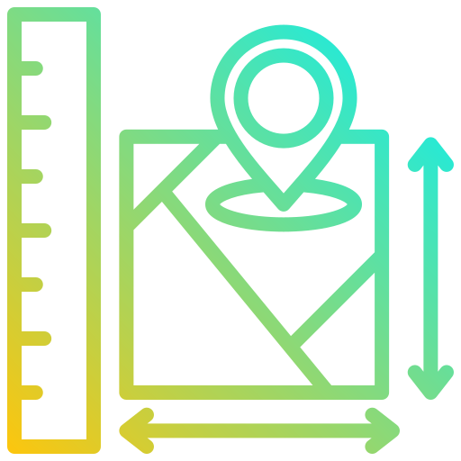
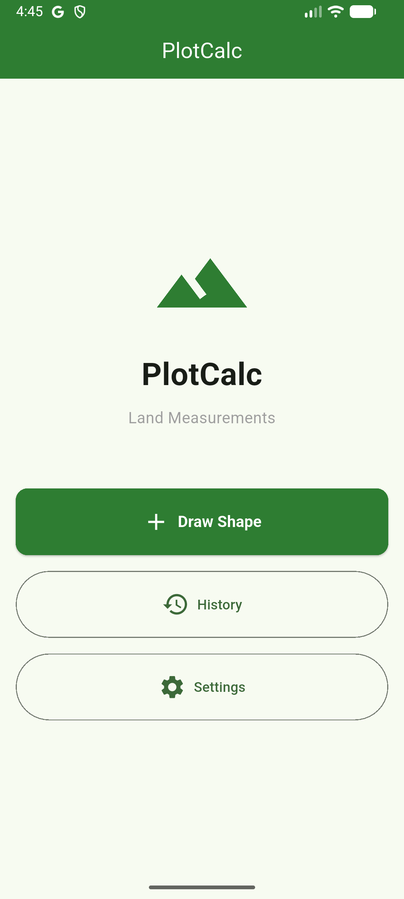
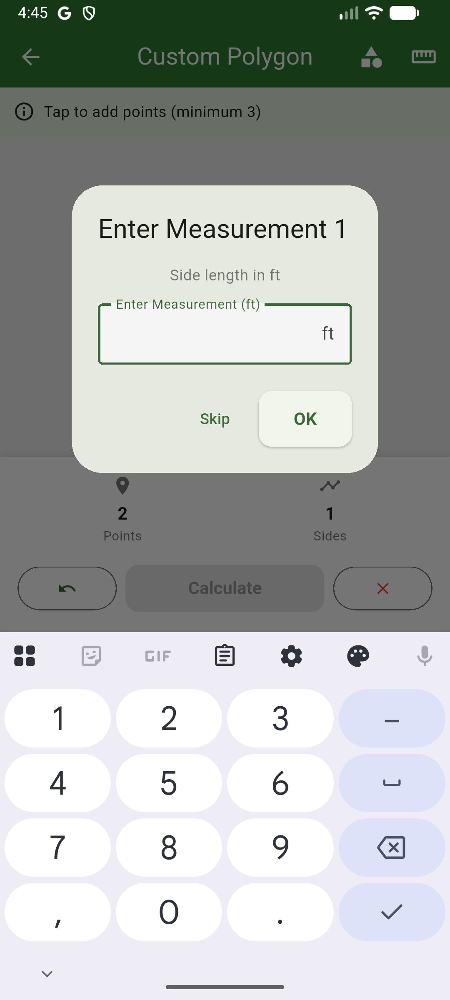
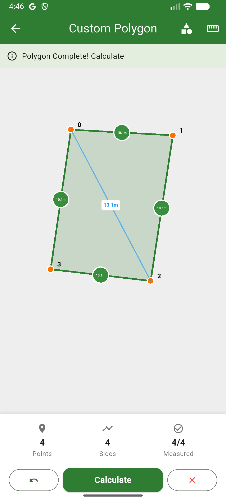
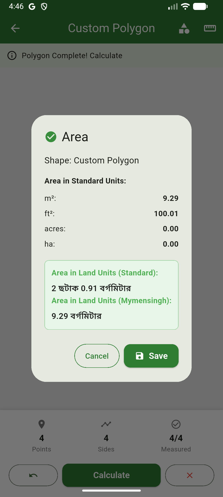
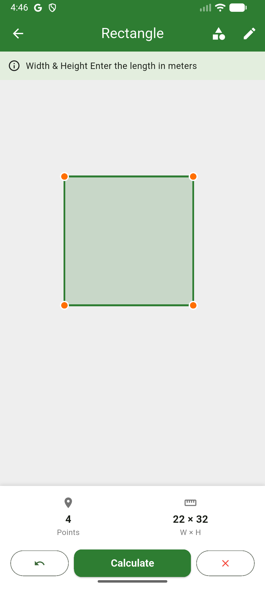
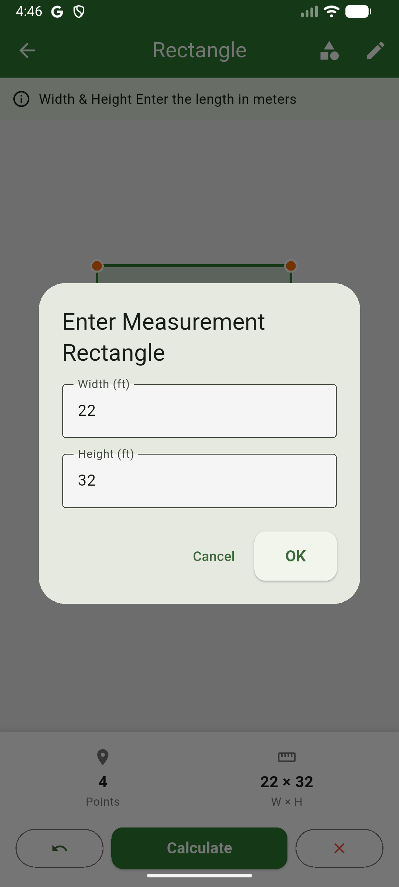
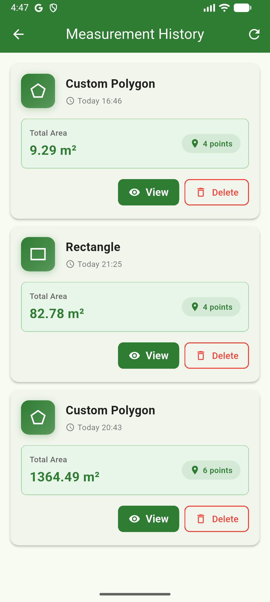
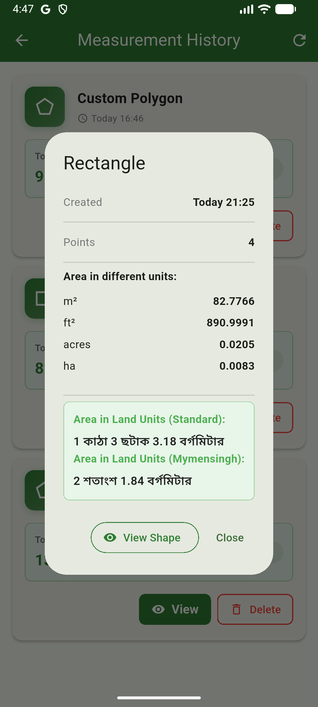
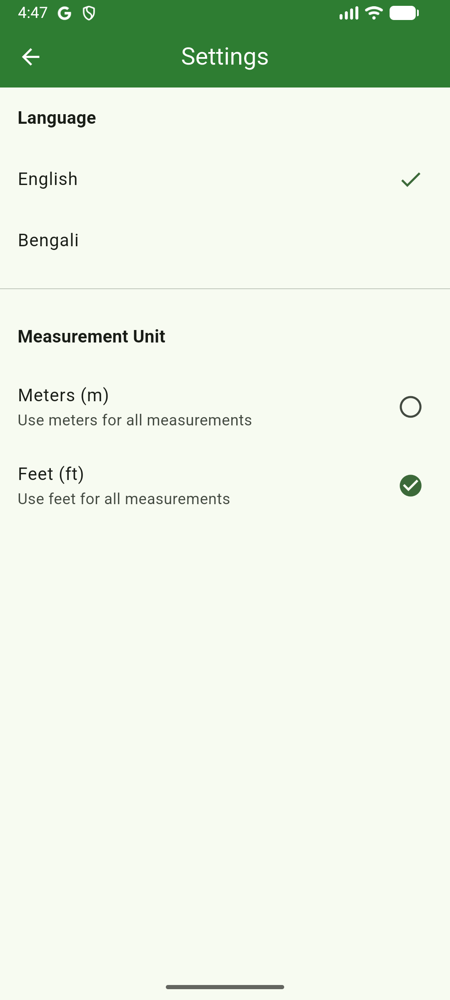

# PlotCalc - Professional Land Area Calculator

<div align="center">PlotCalc

  

  **PlotCalc** - A professional land measurement calculator for surveying, real estate, farming, and construction.

</div>


## 🎯 Features[online documentation](https://docs.flutter.dev/), which offers tutorials,

samples, guidance on mobile development, and a full API reference.

- **Multi-Shape Support**: Rectangle, Triangle, Quadrilateral (4-sided polygon), and Circle measurements
- **Dual Unit System**: Switch between Meters and Feet for all measurements
- **Measurement History**: Keep track of all previous measurements with details
- **Multi-Language Support**: Available in English, Bengali, Spanish, French, and German
- **Offline Calculator**: No internet required, all calculations are local
- **Precision Calculations**: Professional-grade area calculations with accurate formulas
- **Beautiful UI**: Modern, responsive design optimized for all screen sizes

---

## 📱 Screenshots

<table>
  <tr>
    <td align="center"><br><b>Home Screen</b></td>
    <td align="center"><br><b>Input Measurements</b></td>
    <td align="center"><br><b>Polygon</b></td>
  </tr>
  <tr>
    <td align="center"><br><b>View Results</b></td>
    <td align="center"><br><b>Rectangle</b></td>
    <td align="center"><br><b>Edit Measurements</b></td>
  </tr>
  <tr>
    <td align="center"><br><b>Measurement Result</b></td>
    <td align="center"><br><b>Result Display</b></td>
    <td align="center"><br><b>Settings & Preferences</b></td>
  </tr>
</table>

---

## 🚀 Getting Started

### Prerequisites

- Flutter SDK 3.9.2 or higher
- Dart 3.0+
- Android SDK 7.0+ or iOS 11.0+

### Installation

1. **Clone the repository**
   ```bash
   git clone https://github.com/zamansheikh/plotcalc.git
   cd plotcalc
   ```

2. **Install dependencies**
   ```bash
   flutter pub get
   ```

3. **Run the app**
   ```bash
   flutter run
   ```

4. **Build Release APK** (Android)
   ```bash
   flutter build apk --release
   ```

5. **Build Release IPA** (iOS)
   ```bash
   flutter build ios --release
   ```

---

## 💡 How to Use

### Quick Start

1. **Select a Shape**: Choose from Rectangle, Triangle, Quadrilateral, or Circle
2. **Enter Measurements**: Input the required dimensions
3. **Choose Unit**: Select Meters or Feet from Settings
4. **View Results**: See calculated area instantly
5. **Save History**: Measurements are automatically saved

### Supported Shapes

| Shape | Required Input | Formula |
|-------|---|---|
| **Rectangle** | Length × Width | Area = Length × Width |
| **Triangle** | Base × Height | Area = ½ × Base × Height |
| **Quadrilateral** | All 4 sides & diagonals | Bretschneider's Formula |
| **Circle** | Radius | Area = π × r² |

### Unit Conversion

- **1 Foot** = 0.3048 Meters
- **1 Square Meter** = 10.764 Square Feet
- All internal calculations use Meters; display converts based on user preference

---

## 🛠 Tech Stack

- **Framework**: Flutter 3.9.2+
- **Language**: Dart 3.0+
- **State Management**: BLoC Pattern (flutter_bloc 9.1.1+)
- **Local Storage**: SQLite (sqflite 2.4.2+)
- **Preferences**: SharedPreferences (2.3.3+)
- **Routing**: GoRouter (16.3.0+)
- **Localization**: flutter_localizations + intl (0.20.2+)

---

## 📁 Project Structure

```
plotcalc/
├── lib/
│   ├── main.dart                 # App entry point
│   ├── core/
│   │   ├── constants/            # App constants
│   │   ├── database/             # SQLite setup
│   │   ├── di/                   # Dependency injection
│   │   ├── error/                # Error handling
│   │   ├── localization/         # Multi-language support
│   │   ├── router/               # GoRouter configuration
│   │   ├── theme/                # App theme & colors
│   │   ├── usecases/             # Business logic
│   │   └── utils/                # Utility functions
│   └── features/
│       ├── measurement/          # Measurement feature
│       └── settings/             # Settings feature
├── assets/
│   └── icon/                     # App icon
├── docs/
│   ├── screenshots/              # App screenshots
│   ├── index.html                # Landing page
│   └── privacy.html              # Privacy policy
├── android/                      # Android configuration
├── ios/                          # iOS configuration
├── test/                         # Unit & widget tests
└── pubspec.yaml                  # Dependencies
```

---

## 🎨 Design System

- **Primary Colors**: Purple gradient (#667eea to #764ba2)
- **Accent Color**: Teal (#00BCD4)
- **Responsive Design**: Works on all screen sizes
- **Material Design**: Follows Material Design 3 guidelines

---

## 📊 App Specifications

| Specification | Details |
|---|---|
| **Min Android** | 7.0 (SDK 24) |
| **Min iOS** | 11.0 |
| **Release APK Size** | ~47 MB |
| **Version** | 1.0.0 |
| **Languages** | 5 (English, Bengali, Spanish, French, German) |
| **Offline** | ✅ Yes |
| **Ads** | ❌ No |
| **Analytics** | ❌ No |

---

## 🔒 Privacy & Security

- **No Data Collection**: The app does not collect any personal data
- **Local Storage Only**: All measurements are stored locally on your device
- **No Cloud Sync**: No data is sent to external servers
- **No Ads or Tracking**: Completely ad-free and tracking-free
- **Open Source**: Code is transparent and auditable

For detailed information, see [Privacy Policy](docs/privacy.html)

---

## 📚 Supported Use Cases

✅ **Surveyors** - Professional land surveying and measurement  
✅ **Real Estate** - Property area calculation and valuation  
✅ **Farmers** - Agricultural land measurement  
✅ **Architects** - Site planning and design calculations  
✅ **Engineers** - Construction site measurements  
✅ **Students** - Learning geometry and area calculations  

---

## 🤝 Contributing

Contributions are welcome! Please feel free to:

1. Fork the repository
2. Create a feature branch (`git checkout -b feature/AmazingFeature`)
3. Commit your changes (`git commit -m 'Add some AmazingFeature'`)
4. Push to the branch (`git push origin feature/AmazingFeature`)
5. Open a Pull Request

---

## 📝 License

This project is licensed under the MIT License - see the [LICENSE](LICENSE) file for details.

---

## 👨‍💻 Author

**Md. Shamsuzzaman**

- 📧 Email: zaman6545@gmail.com
- 🌐 Website: [zamansheikh.com](https://zamansheikh.com)
- 💼 Company: [Programmer Nexus](https://programmernexus.com)
- 🔗 GitHub: [@zamansheikh](https://github.com/zamansheikh)

---

## 🙏 Acknowledgments

- Flutter and Dart communities
- All contributors and testers
- Inspired by professional surveying tools

---

## 📞 Support

For issues, questions, or suggestions, please:

1. **Open an Issue** on [GitHub Issues](https://github.com/zamansheikh/plotcalc/issues)
2. **Contact**: zaman6545@gmail.com
3. **Visit**: [Project Landing Page](https://zamansheikh.github.io/plotcalc/)

---

<div align="center">
  <p>Made with ❤️ by <a href="https://github.com/zamansheikh">Md. Shamsuzzaman</a></p>
  <p><a href="https://github.com/zamansheikh/plotcalc">⭐ Star this repo if you find it useful!</a></p>
</div>
